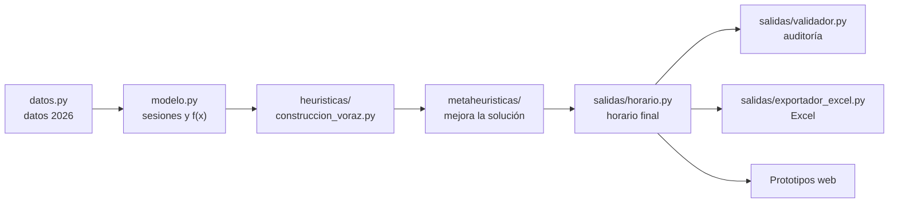

# Carpeta `notebooks/` — código del generador de horarios

Aquí está todo el código Python del proyecto: el generador de horarios (heurísticas y metaheurísticas), el script para comparar métodos y el modelo matemático exacto. Los prototipos web (`Prototipos/`) usan este código para obtener sus datos.

> A pesar del nombre, la carpeta no contiene notebooks de Jupyter. Se mantiene el nombre porque los prototipos buscan el generador en `notebooks/`.

## Qué ejecutar

| Script | Para qué sirve | Comando |
| :--- | :--- | :--- |
| `generador_horarios.py` | Genera el horario, escribe los Excel en `Outputs Excel/` y abre la consola de consulta. | `python notebooks/generador_horarios.py` |
| `comparar_metaheuristicas.py` | Compara los métodos de mejora: factibilidad, costo, tiempo de ejecución y calidad, con varias semillas. | `python notebooks/comparar_metaheuristicas.py` |
| `modelo_matematico.py` | Resuelve el problema con un modelo de programación entera (requiere `pip install ortools`; con `--solver GUROBI`, `pip install gurobipy` y licencia). Con `--elastico` calcula la menor cantidad de violaciones duras posible; con `--franjas-moviles` el modelo también elige los bloques de las franjas de electivos. | `python notebooks/modelo_matematico.py --solver GUROBI` |

Las opciones de cada script se ven con `--help`.

## Estructura

```text
notebooks/
├── README.md                        Esta guía
├── generador_horarios.py            Script principal (horario + Excel + consola)
├── comparar_metaheuristicas.py      Script de comparación de métodos
├── modelo_matematico.py             Script del modelo de programación entera
├── Outputs Excel/                   Excel que escribe generador_horarios.py
│   ├── Horario_Cursos_MMDD.xlsx
│   └── Horarios_Docentes_Colegio_MMDD.xlsx
└── horarios/                        Paquete con el código, por fases
    ├── datos.py                     1. Entrada: datos del colegio 2026
    ├── modelo.py                    2. Representación y función objetivo
    ├── heuristicas/                 3. Heurísticas
    │   ├── construccion_voraz.py       solución inicial
    │   └── min_conflicts.py            búsqueda local (operadores comunes)
    ├── mejora.py                    4. Clases base de los métodos de mejora + medición de tiempos
    ├── metaheuristicas/             4. Metaheurísticas (una por archivo)
    │   ├── busqueda_tabu.py
    │   ├── busqueda_local_iterada.py
    │   └── min_conflicts_tabu.py       híbrido, método por defecto
    ├── motor.py                     5. Encadena las fases y mide sus tiempos
    └── salidas/                     6. Trabajo sobre el horario ya generado
        ├── horario.py                  estructura del horario final
        ├── validador.py                auditoría de restricciones
        ├── exportador_excel.py         libros .xlsx
        └── menu.py                     consola
```

## Cómo se genera un horario



`motor.py` ejecuta los pasos B a E y mide el tiempo de cada uno. `modelo_matematico.py` parte de la misma instancia (B), pero resuelve con un solver en vez de con heurísticas, y entrega su resultado a E y F.

## Para qué sirve cada archivo

| Archivo | Para qué sirve | Quién lo usa | ¿Se deja? |
| :--- | :--- | :--- | :--- |
| `generador_horarios.py` | Punto de entrada: genera el horario, los Excel y la consola. | Usuario; los prototipos importan clases desde aquí. | **Sí.** Si se borra o renombra, los prototipos dejan de funcionar. |
| `comparar_metaheuristicas.py` | Experimento para elegir el mejor método (tiempos, factibilidad, calidad). | Usuario. | **Sí.** |
| `modelo_matematico.py` | Modelo exacto: valida que las metaheurísticas llegan al óptimo y sirve de referencia de tiempo y calidad. | Usuario. | **Sí.** |
| `pyproject.toml` | Empaqueta el motor (`horarios`, `generador_horarios`, `modelo_matematico`) para instalarlo como dependencia. | Solver en línea del Prototipo 2 en Vercel. | **Sí.** Si se borra, el solver de la página publicada deja de funcionar; los scripts locales no lo necesitan. |
| `Outputs Excel/*.xlsx` | Entregables para el colegio. Se regeneran en cada ejecución del generador. | Colegio / equipo. | **Sí**, como entregable. Si molesta que cambien en cada ejecución, se pueden sacar del repositorio y agregar a `.gitignore`. |
| `horarios/__init__.py` | Expone las clases del paquete (`from horarios import ...`). | Todos los scripts. | **Sí.** |
| `horarios/datos.py` | Parámetros 2026: bloques, jornadas, docentes, mallas, electivos, recintos y salas. | Todo el paquete. | **Sí.** Es la única fuente de datos del generador. |
| `horarios/modelo.py` | Divide cada asignatura en sesiones y calcula la función objetivo de forma incremental. | Heurísticas, metaheurísticas y modelo matemático. | **Sí.** |
| `horarios/heuristicas/construccion_voraz.py` | Heurística constructiva: arma la solución inicial. | `motor.py`. | **Sí.** |
| `horarios/heuristicas/min_conflicts.py` | Heurística de búsqueda local y sus operadores (elegir conflicto, mejor intercambio). | Todas las metaheurísticas. | **Sí.** |
| `horarios/mejora.py` | Clases base `MetodoMejora` y `Metaheuristica` y medición de tiempo (`Seguimiento`). | Heurísticas y metaheurísticas de mejora. | **Sí.** Garantiza que todos los métodos se midan igual. |
| `horarios/metaheuristicas/busqueda_tabu.py` | Búsqueda tabú. | Comparación; partes reusadas por el híbrido. | **Sí.** |
| `horarios/metaheuristicas/busqueda_local_iterada.py` | Búsqueda local iterada (ILS). | Comparación; partes reusadas por el híbrido. | **Sí.** |
| `horarios/metaheuristicas/min_conflicts_tabu.py` | Híbrido que genera los horarios oficiales del proyecto. | `motor.py` (por defecto). | **Sí.** |
| `horarios/metaheuristicas/__init__.py` | Registro de métodos e instrucciones para agregar uno nuevo. | Scripts. | **Sí.** |
| `horarios/motor.py` | Encadena modelo, construcción y mejora; mide tiempos. | Scripts y prototipos. | **Sí.** |
| `horarios/salidas/horario.py` | Estructura del horario final (por curso, docente y recinto). | Validador, exportador, consola, prototipos. | **Sí.** |
| `horarios/salidas/validador.py` | Auditoría independiente de todas las restricciones. | Scripts, Excel, prototipos. | **Sí.** |
| `horarios/salidas/exportador_excel.py` | Escribe los Excel con el diseño oficial del colegio. | Generador, modelo matemático, Prototipo 2. | **Sí.** |
| `horarios/salidas/menu.py` | Consola: consultar cursos y docentes, auditar y exportar. | `generador_horarios.py`. | **Sí.** |

## Limpieza realizada

| Eliminado | Motivo |
| :--- | :--- |
| `Outputs Excel/~$Horarios_Docentes_Colegio_MMDD.xlsx` | Archivo temporal de bloqueo que Excel crea mientras un libro está abierto; se subió por error. Ahora `.gitignore` ignora `~$*`. |
| `horarios/metaheuristicas/base.py` | Solo definía una subclase vacía; la clase `Metaheuristica` quedó en `mejora.py`, junto a la base común. |
| `HorarioEscolar.esta_disponible` y `HorarioEscolar.desasignar` | Restos de una versión anterior del algoritmo; nadie los usaba. |
| `ExportadorExcel.exportar_horario` y `MotorHorarios.PESO_DURO` / `PESO_PATIO` (el Patio Santo Domingo ya no es recinto deportivo) | Alias sin uso. |
| Reexportaciones sobrantes en `generador_horarios.py` | Solo quedan las clases que importan los prototipos. |

Además, `horario.py`, `validador.py`, `exportador_excel.py` y `menu.py` se agruparon en `horarios/salidas/`. Los horarios generados y los datos que exporta el Prototipo 2 no cambian.
