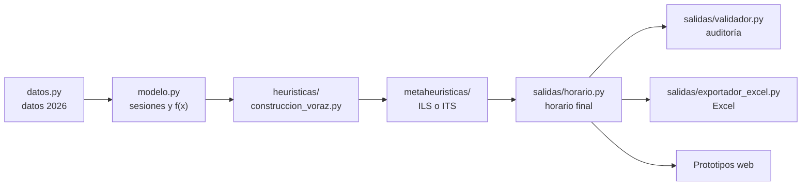

# Carpeta `notebooks/` — código del generador de horarios

Aquí está todo el código Python del proyecto: el generador de horarios (heurística constructiva y metaheurísticas), el script para comparar métodos y el modelo matemático exacto. Los prototipos web (`Prototipos/`) usan este código para obtener sus datos.

## Metodología

1. **Heurística constructiva voraz** (`heuristicas/construccion_voraz.py`): arma la solución inicial. Ubica cada sesión, de la más restringida a la menos restringida, en la posición que agrega menos costo. El horario queda completo (cada curso cubre su malla y su jornada), pero con violaciones duras: unas 50 con la semilla 3.
2. **Metaheurística de mejora**: repara la solución inicial hasta f(x) = 0. Hay dos, con el mismo vecindario y la misma perturbación (`metaheuristicas/vecindario.py`), de modo que la comparación de horarios y tiempos dependa solo de la estrategia de búsqueda:

| Metaheurística | Búsqueda local | Archivo |
| :--- | :--- | :--- |
| **ILS** · búsqueda local iterada | Descenso de mayor pendiente: aplica el mejor intercambio mientras baje f(x) (con un número limitado de movimientos laterales) y se detiene en el primer óptimo local. | `metaheuristicas/busqueda_local_iterada.py` |
| **ITS** · búsqueda tabú iterada (por defecto) | Búsqueda tabú: aplica el mejor intercambio admisible aunque empeore f(x), con lista tabú y criterio de aspiración, hasta `largo_tabu` pasos sin mejora. | `metaheuristicas/busqueda_tabu_iterada.py` |

En ambas, el ciclo es: búsqueda local → **perturbación** (k intercambios al azar) → búsqueda local → **aceptación** (la nueva solución reemplaza a la actual si no es peor), hasta f(x) = 0, `max_pasos` o `tiempo_max`.

- **Movimiento:** intercambio de sesiones dentro de un curso. Un bloque doble se intercambia con otro par pedagógico; un bloque simple, con otra celda simple o libre. Así nunca cambian la carga horaria ni la jornada.
- **Vecindario N(x):** todos los intercambios de las sesiones que participan en alguna violación. Se evalúa completo en cada paso y se elige el mejor; los empates se deciden al azar.
- **f(x) = 1000 · violaciones duras:** choques de docentes, una asignatura repetida en el día, sala de English skills y gimnasios.

### Calibración y resultados

Parámetros por defecto, elegidos con las semillas 1 a 5 y un límite de 30 s:

| Parámetro | ILS | ITS | Qué se probó |
| :--- | :---: | :---: | :--- |
| `perturbaciones` (k) | 15 | 15 | 4, 8 y 15: con k = 4 la ILS a veces no sale de su óptimo local en 30 s. |
| `laterales` | 10 | – | 0, 10, 30 y 100: con 0 la ILS tarda unos 15 s; con 100 se pierde en mesetas. |
| `tabu_min` + U[0, `tabu_rango`] | – | 10 + U[0, 10] | `tabu_min` 5 y 10: diferencias menores. |
| `largo_tabu` | – | 150 | 50 y 150: diferencias menores. |
| `vecindario` | conflictos | conflictos | `completo` (todas las sesiones): 0 de 5 factibles en 30 s, cada paso evalúa ~25 veces más intercambios. |

Comparación final con las semillas 1 a 10 (`python notebooks/comparar_metaheuristicas.py`; CSV en `resultados/comparacion_ils_its_2026-11-11.csv`): **ITS** llega a $f(x) = 0$ en 10 de 10 con mediana de 1,4 s (peor caso 5,4 s); **ILS** en 10 de 10 con mediana de 9,3 s (peor caso 22 s). ITS fue más rápida en todas las semillas.

Hasta noviembre de 2026 el motor usaba Min-Conflicts: en cada paso, una sola sesión en conflicto elegida al azar. Con él se generaron las instancias 2027 del *6 de octubre* y del *3 de noviembre*, que siguen guardadas en `Prototipos/Prototipo 2/datos/instancias/`. El código anterior está en el historial de git (por ejemplo, el commit `1159c14`).

> A pesar del nombre, la carpeta no contiene notebooks de Jupyter. Se mantiene el nombre porque los prototipos buscan el generador en `notebooks/`.

## Qué ejecutar

| Script | Para qué sirve | Comando |
| :--- | :--- | :--- |
| `generador_horarios.py` | Genera el horario, escribe los Excel en `Outputs Excel/` y abre la consola de consulta. | `python notebooks/generador_horarios.py` |
| `comparar_metaheuristicas.py` | Compara ILS e ITS: factibilidad, costo, tiempo de ejecución, iteraciones y calidad (ventanas, % de bloques dobles), con varias semillas. Guarda CSV con `--csv` y curvas de convergencia con `--convergencia`. | `python notebooks/comparar_metaheuristicas.py` |
| `modelo_matematico.py` | Resuelve el problema con un modelo de programación entera (requiere `pip install ortools`; con `--solver GUROBI`, `pip install gurobipy` y licencia). Con `--elastico` calcula la menor cantidad de violaciones duras posible; con `--franjas-moviles` el modelo también elige los bloques de las franjas de electivos. | `python notebooks/modelo_matematico.py --solver GUROBI` |

Las opciones de cada script se ven con `--help`.

## Estructura

```text
notebooks/
├── README.md                        Esta guía
├── generador_horarios.py            Script principal (horario + Excel + consola)
├── comparar_metaheuristicas.py      Script de comparación de métodos
├── modelo_matematico.py             Script del modelo de programación entera
├── resultados/                      CSV de las comparaciones de ILS e ITS (comparar_metaheuristicas.py --csv)
├── Outputs Excel/                   Excel que escribe generador_horarios.py
│   ├── Horario_Cursos_MMDD.xlsx
│   └── Horarios_Docentes_Colegio_MMDD.xlsx
└── horarios/                        Paquete con el código, por fases
    ├── datos.py                     1. Entrada: datos del colegio 2026
    ├── modelo.py                    2. Representación y función objetivo
    ├── heuristicas/                 3. Heurística constructiva
    │   └── construccion_voraz.py       solución inicial
    ├── mejora.py                    4. Clase base de las metaheurísticas + medición de tiempos
    ├── metaheuristicas/             4. Metaheurísticas (una por archivo)
    │   ├── vecindario.py               vecindario, evaluación y perturbación comunes
    │   ├── busqueda_local_iterada.py   ILS
    │   └── busqueda_tabu_iterada.py    ITS, método por defecto
    ├── motor.py                     5. Encadena las fases y mide sus tiempos
    └── salidas/                     6. Trabajo sobre el horario ya generado
        ├── horario.py                  estructura del horario final
        ├── validador.py                auditoría de restricciones
        ├── exportador_excel.py         libros .xlsx
        ├── documentos.py               Word y PDF (horarios y distribución horaria)
        └── menu.py                     consola
```

## Cómo se genera un horario



`motor.py` ejecuta los pasos B a E y mide el tiempo de cada uno. `modelo_matematico.py` parte de la misma instancia (B), pero resuelve con un solver en vez de con heurísticas, y entrega su resultado a E y F.

## Para qué sirve cada archivo

| Archivo | Para qué sirve | Quién lo usa | ¿Se deja? |
| :--- | :--- | :--- | :--- |
| `generador_horarios.py` | Punto de entrada: genera el horario, los Excel y la consola. | Usuario; los prototipos importan clases desde aquí. | **Sí.** Si se borra o renombra, los prototipos dejan de funcionar. |
| `comparar_metaheuristicas.py` | Experimento para comparar ILS e ITS (horarios, tiempos, factibilidad, calidad). | Usuario. | **Sí.** |
| `modelo_matematico.py` | Modelo exacto: valida que las metaheurísticas llegan al óptimo y sirve de referencia de tiempo y calidad. | Usuario. | **Sí.** |
| `pyproject.toml` | Empaqueta el motor (`horarios`, `generador_horarios`, `modelo_matematico`) para instalarlo como dependencia. | Solver en línea del Prototipo 2 en Vercel. | **Sí.** Si se borra, el solver de la página publicada deja de funcionar; los scripts locales no lo necesitan. |
| `Outputs Excel/*.xlsx` | Entregables para el colegio. Se regeneran en cada ejecución del generador. | Colegio / equipo. | **Sí**, como entregable. Si molesta que cambien en cada ejecución, se pueden sacar del repositorio y agregar a `.gitignore`. |
| `horarios/__init__.py` | Expone las clases del paquete (`from horarios import ...`). | Todos los scripts. | **Sí.** |
| `horarios/datos.py` | Parámetros 2026: bloques, jornadas, docentes, mallas, electivos, recintos y salas. | Todo el paquete. | **Sí.** Es la única fuente de datos del generador. |
| `horarios/modelo.py` | Divide cada asignatura en sesiones y calcula la función objetivo de forma incremental. | Heurísticas, metaheurísticas y modelo matemático. | **Sí.** |
| `horarios/heuristicas/construccion_voraz.py` | Heurística constructiva: arma la solución inicial. | `motor.py`. | **Sí.** |
| `horarios/mejora.py` | Clases base `MetodoMejora` y `Metaheuristica` y medición de tiempo (`Seguimiento`). | ILS e ITS. | **Sí.** Garantiza que todos los métodos se midan igual. |
| `horarios/metaheuristicas/vecindario.py` | Operadores comunes: vecindario N(x), evaluación incremental, mejor movimiento y perturbación. | ILS e ITS. | **Sí.** Si cambia, cambia para los dos métodos. |
| `horarios/metaheuristicas/busqueda_local_iterada.py` | Búsqueda local iterada (ILS): descenso + perturbación + aceptación. | `motor.py`, comparación. | **Sí.** |
| `horarios/metaheuristicas/busqueda_tabu_iterada.py` | Búsqueda tabú iterada (ITS): búsqueda tabú + perturbación + aceptación. | `motor.py` (por defecto), comparación. | **Sí.** |
| `horarios/metaheuristicas/__init__.py` | Registro de métodos e instrucciones para agregar uno nuevo. | Scripts. | **Sí.** |
| `horarios/motor.py` | Encadena modelo, construcción y mejora; mide tiempos. | Scripts y prototipos. | **Sí.** |
| `horarios/salidas/horario.py` | Estructura del horario final (por curso, docente y recinto). | Validador, exportador, consola, prototipos. | **Sí.** |
| `horarios/salidas/validador.py` | Auditoría independiente de todas las restricciones. | Scripts, Excel, prototipos. | **Sí.** |
| `horarios/salidas/exportador_excel.py` | Escribe los Excel con el diseño oficial del colegio. | Generador, modelo matemático, Prototipo 2. | **Sí.** |
| `horarios/salidas/documentos.py` | Horarios de cursos en Word y PDF (diseño del Excel 2026) y distribución horaria docente en Word y PDF (formato del Word 2026). Requiere `python-docx` y `reportlab`. | Prototipo 2 (`/api/exportar`). | **Sí.** |
| `horarios/salidas/menu.py` | Consola: consultar cursos y docentes, auditar y exportar. | `generador_horarios.py`. | **Sí.** |

## Limpieza realizada

| Eliminado | Motivo |
| :--- | :--- |
| `Outputs Excel/~$Horarios_Docentes_Colegio_MMDD.xlsx` | Archivo temporal de bloqueo que Excel crea mientras un libro está abierto; se subió por error. Ahora `.gitignore` ignora `~$*`. |
| `horarios/metaheuristicas/base.py` | Solo definía una subclase vacía; la clase `Metaheuristica` quedó en `mejora.py`, junto a la base común. |
| `HorarioEscolar.esta_disponible` y `HorarioEscolar.desasignar` | Restos de una versión anterior del algoritmo; nadie los usaba. |
| `ExportadorExcel.exportar_horario` y `MotorHorarios.PESO_DURO` / `PESO_PATIO` (el Patio Santo Domingo ya no es recinto deportivo) | Alias sin uso. |
| Reexportaciones sobrantes en `generador_horarios.py` | Solo quedan las clases que importan los prototipos. |
| `heuristicas/min_conflicts.py`, `metaheuristicas/busqueda_tabu.py` y `metaheuristicas/min_conflicts_tabu.py` (noviembre de 2026) | La metodología pasó a heurística constructiva + ILS/ITS sin Min-Conflicts. Las instancias 2027 generadas con esos métodos siguen guardadas en el Prototipo 2. |

Además, `horario.py`, `validador.py`, `exportador_excel.py` y `menu.py` se agruparon en `horarios/salidas/`. Los horarios generados y los datos que exporta el Prototipo 2 no cambian.
